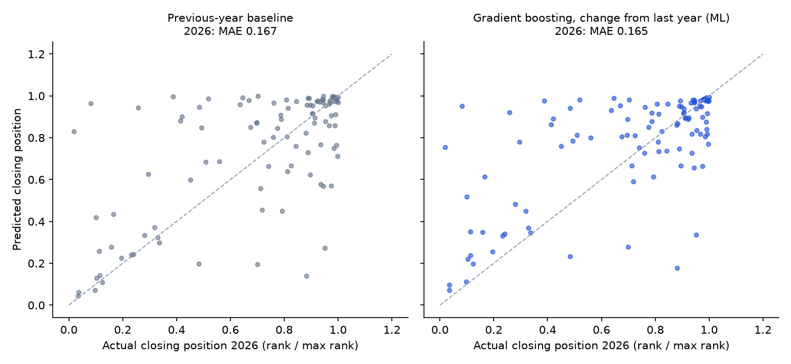
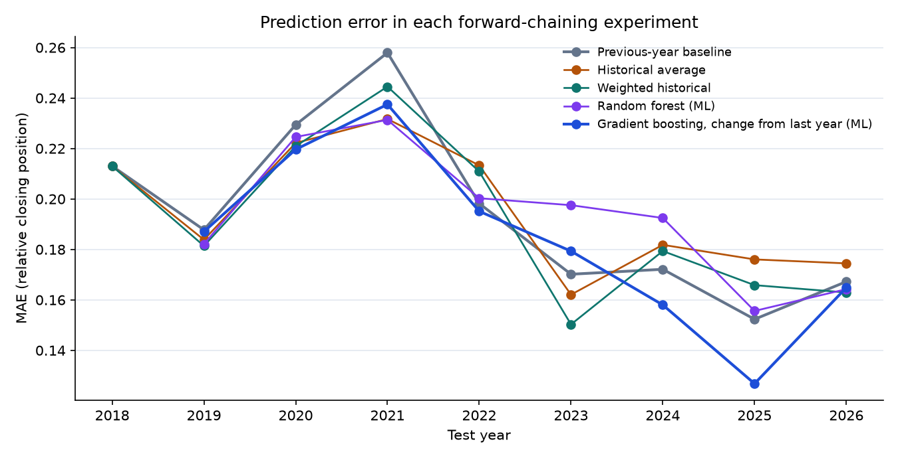
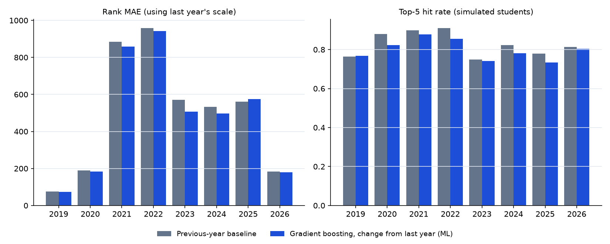
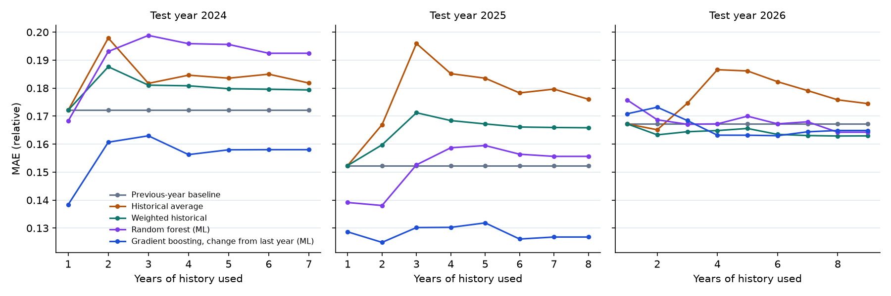

# Forward-chaining benchmark: MCA closing-rank prediction

Generated by `pipeline/benchmark_forward_chain.py` from `data/processed/mca_cutoffs_clean.json`. Years in data: 2017–2026 (10 years, 9 experiments). Every number below is computed, not estimated.

## Data used

- **Years used: 2017–2026** (`ML_FIRST_YEAR` in `predict_next_year.py`). Earlier cut-offs are in the data inspection below and on the website, but are not used to train or test any approach.
- Unit: seat pool = college × social category × gender, ordinary seats, Round 1, domicile merged.
- Seat pools: 303; pool-year rows usable as ML training examples: 1041.
- Highest Round-1 closing rank per year (the list size): 2017: 403, 2018: 365, 2019: 326, 2020: 550, 2021: 1,769, 2022: 3,354, 2023: 2,682, 2024: 1,943, 2025: 1,092, 2026: 1,091.
- **Graduation percentage is not available for any benchmark year.** Only the 2026 Round-2 list prints merit percentages (145 rows, one year), so the benchmark predicts closing **ranks**.

## Data inspection (from `data/processed/mca_cutoffs_clean.json`)

3,028 cut-off rows, years 2017–2026 (10 admission years; the brief assumed 8, the data has more, so there are more experiments).

**Lists published per year** (R1 = first round, R2 = second round, SP = special rounds; 'result awaited' = separate lists for candidates whose degree result was pending):

| Year | Round | Result-awaited list | Rows |
|---|---|---|---|
| 2017 | R1 | no | 73 |
| 2017 | SP1 | no | 27 |
| 2017 | SP2 | no | 8 |
| 2018 | R1 | no | 76 |
| 2019 | R1 | no | 76 |
| 2020 | R1 | no | 128 |
| 2020 | R1 | yes | 144 |
| 2021 | R1 | no | 208 |
| 2021 | R1 | yes | 88 |
| 2021 | R2 | no | 189 |
| 2021 | R2 | yes | 50 |
| 2022 | R1 | no | 256 |
| 2022 | R2 | no | 205 |
| 2023 | R1 | no | 234 |
| 2023 | R2 | no | 216 |
| 2024 | R1 | no | 151 |
| 2025 | R1 | no | 270 |
| 2025 | R2 | no | 352 |
| 2026 | R1 | no | 132 |
| 2026 | R2 | no | 145 |

**Per year:**

| Year | Rows | Colleges | Names without College ID | Female-seat rows | NCC/divyang rows | Converted rows | Domicile given | %-score rows | Rows used by benchmark |
|---|---|---|---|---|---|---|---|---|---|
| 2017 | 108 | 28 | 0 | 32 | 0 | 0 | 80 | 0 | 73 |
| 2018 | 76 | 25 | 0 | 21 | 1 | 0 | 50 | 0 | 75 |
| 2019 | 76 | 23 | 0 | 20 | 0 | 0 | 51 | 0 | 76 |
| 2020 | 272 | 42 | 0 | 42 | 0 | 0 | 118 | 0 | 128 |
| 2021 | 535 | 45 | 0 | 70 | 3 | 0 | 199 | 0 | 208 |
| 2022 | 461 | 44 | 0 | 52 | 3 | 0 | 180 | 0 | 255 |
| 2023 | 450 | 47 | 0 | 56 | 3 | 0 | 177 | 0 | 232 |
| 2024 | 151 | 46 | 0 | 22 | 3 | 0 | 76 | 0 | 148 |
| 2025 | 622 | 51 | 0 | 56 | 1 | 0 | 247 | 0 | 269 |
| 2026 | 277 | 51 | 0 | 43 | 2 | 12 | 159 | 145 | 126 |

**Columns and how often they are filled:** `college_id` 100%, `id_match` 100%, `institute_name_raw` 100%, `year` 100%, `round` 100%, `round_label` 100%, `result_awaited` 100%, `branch` 100%, `institute_type_raw` 96%, `fee_waiver_seat` 92%, `opening_rank` 100%, `closing_rank` 100%, `opening_score` 5%, `closing_score` 5%, `category_raw` 100%, `social` 100%, `seat_class` 77%, `gender` 100%, `after_conversion` 100%, `eligible_category_raw` 21%, `domicile` 44%, `domicile_raw` 44%, `total_allotted` 100%.

**Quality checks:** exact duplicate rows: 0; 797 rows are printed splits of 272 seat pools (by domicile, or in 2025 by the candidate's own eligible category); they are not duplicates and are merged by taking the highest closing rank; missing closing rank: 0; missing opening rank: 0; opening rank > closing rank: 0. College-name → official ID matching (provisional = a college not in the current intake list, kept under its own ID): alias 163, exact 2692, provisional 173 rows.

**What the data does and does not contain:**

- Available every year: college, closing and opening **rank**, category (social/class/gender), seats allotted, round. Domicile is printed only in some years; it is merged, not compared.
- **Graduation-percentage cut-offs** appear only in 2026 (145 rows). A percentage-based model therefore cannot be trained or tested across years.
- **Individual allotments** (which student got which college) are not in the data: the merit lists that contain them hold personal data and are deliberately kept out. Allotment accuracy is therefore measured with simulated student ranks against the published cut-offs.
- Round 2 lists exist for 2021, 2022, 2023, 2025, 2026 (none for 2024); special rounds only for 2017. Only Round 1 exists in every year, so the benchmark uses Round 1 to compare like with like.

## Summary table

Error = MAE of relative closing position (lower is better). Rank errors in brackets (MAE in ranks, using the previous year's scale). Both ML models are shown: Gradient boosting, change from last year (ML) (better overall, used on the website) and Random forest (ML), so every 'best approach' can be read off the table.

| Training data | Test year | Previous-year baseline error | ML error: Gradient boosting, change from last year (ML) | ML error: Random forest (ML) | Weighted model error | Best approach |
|---|---|---|---|---|---|---|
| 2017 | 2018 | 0.213 (89) | n/a (no training pairs yet) | n/a (no training pairs yet) | 0.213 (89) | Previous-year baseline |
| 2017–2018 | 2019 | 0.188 (75) | 0.187 (74) | 0.182 (57) | 0.181 (71) | Weighted historical |
| 2017–2019 | 2020 | 0.229 (190) | 0.220 (183) | 0.225 (188) | 0.221 (189) | Gradient boosting, change from last year (ML) |
| 2017–2020 | 2021 | 0.258 (885) | 0.237 (859) | 0.231 (872) | 0.244 (880) | Random forest (ML) |
| 2017–2021 | 2022 | 0.198 (959) | 0.195 (942) | 0.200 (1045) | 0.211 (1001) | Gradient boosting, change from last year (ML) |
| 2017–2022 | 2023 | 0.170 (572) | 0.179 (506) | 0.198 (464) | 0.150 (563) | Weighted historical |
| 2017–2023 | 2024 | 0.172 (533) | 0.158 (497) | 0.192 (387) | 0.179 (468) | Gradient boosting, change from last year (ML) |
| 2017–2024 | 2025 | 0.152 (561) | 0.127 (575) | 0.156 (460) | 0.166 (490) | Gradient boosting, change from last year (ML) |
| 2017–2025 | 2026 | 0.167 (183) | 0.165 (180) | 0.164 (179) | 0.163 (178) | Weighted historical |

## Main comparison (MAE of relative closing position, lower is better)

Relative position = closing rank ÷ highest closing rank that year. 0.10 means an error of 10% of the rank list.

| Exp | Training data | Test year | Pools | Prev-year baseline | Historical avg | Weighted | Random forest | GBM (change) | Best |
|---|---|---|---|---|---|---|---|---|---|
| 1 | 2017–2017 (1 yr) | 2018 | 50 | 0.213 | 0.213 | 0.213 | n/a | n/a | Previous-year baseline |
| 2 | 2017–2018 (2 yr) | 2019 | 49 | 0.188 | 0.184 | 0.181 | 0.182 | 0.187 | Weighted historical |
| 3 | 2017–2019 (3 yr) | 2020 | 73 | 0.229 | 0.222 | 0.221 | 0.225 | 0.220 | Gradient boosting, change from last year (ML) |
| 4 | 2017–2020 (4 yr) | 2021 | 133 | 0.258 | 0.232 | 0.244 | 0.231 | 0.237 | Random forest (ML) |
| 5 | 2017–2021 (5 yr) | 2022 | 201 | 0.198 | 0.213 | 0.211 | 0.200 | 0.195 | Gradient boosting, change from last year (ML) |
| 6 | 2017–2022 (6 yr) | 2023 | 213 | 0.170 | 0.162 | 0.150 | 0.198 | 0.179 | Weighted historical |
| 7 | 2017–2023 (7 yr) | 2024 | 129 | 0.172 | 0.182 | 0.179 | 0.192 | 0.158 | Gradient boosting, change from last year (ML) |
| 8 | 2017–2024 (8 yr) | 2025 | 89 | 0.152 | 0.176 | 0.166 | 0.156 | 0.127 | Gradient boosting, change from last year (ML) |
| 9 | 2017–2025 (9 yr) | 2026 | 104 | 0.167 | 0.174 | 0.163 | 0.164 | 0.165 | Weighted historical |

n/a: the ML models need at least one earlier (features → result) year to learn from, so they start at experiment 2.

## Other metrics per experiment

Rank MAE uses last year's rank scale, as a real forecast must. Student metrics: 40 simulated ranks per category group, spread over the test year's list; a college is reachable if rank ≤ its actual closing rank. Top-5 hit = share of the 5 most selective colleges shown as reachable that really were.

| Test year | Approach | RMSE | R² | Rank MAE | Median rank error | Decision accuracy | List precision | List recall | Top-5 hit |
|---|---|---|---|---|---|---|---|---|---|
| 2018 | Previous-year baseline | 0.282 | 0.020 | 89 | 74 | 78% | 81% | 90% | 72% |
| 2018 | Historical average | 0.282 | 0.020 | 89 | 74 | 78% | 81% | 90% | 72% |
| 2018 | Weighted historical | 0.282 | 0.020 | 89 | 74 | 78% | 81% | 90% | 72% |
| 2019 | Previous-year baseline | 0.265 | -0.054 | 75 | 59 | 80% | 84% | 90% | 76% |
| 2019 | Historical average | 0.255 | 0.028 | 70 | 53 | 81% | 85% | 90% | 79% |
| 2019 | Weighted historical | 0.257 | 0.007 | 71 | 59 | 81% | 84% | 90% | 77% |
| 2019 | Random forest (ML) | 0.233 | 0.184 | 57 | 42 | 83% | 86% | 91% | 82% |
| 2019 | Gradient boosting, change from last year (ML) | 0.266 | -0.058 | 74 | 56 | 80% | 84% | 90% | 77% |
| 2020 | Previous-year baseline | 0.313 | -0.068 | 190 | 192 | 66% | 92% | 55% | 88% |
| 2020 | Historical average | 0.301 | 0.010 | 188 | 198 | 67% | 92% | 55% | 87% |
| 2020 | Weighted historical | 0.301 | 0.010 | 189 | 198 | 66% | 92% | 55% | 88% |
| 2020 | Random forest (ML) | 0.278 | 0.158 | 188 | 204 | 67% | 91% | 57% | 87% |
| 2020 | Gradient boosting, change from last year (ML) | 0.299 | 0.023 | 183 | 194 | 68% | 90% | 59% | 82% |
| 2021 | Previous-year baseline | 0.354 | -0.171 | 885 | 1065 | 51% | 94% | 31% | 90% |
| 2021 | Historical average | 0.303 | 0.142 | 877 | 1071 | 52% | 95% | 31% | 91% |
| 2021 | Weighted historical | 0.325 | 0.017 | 880 | 1065 | 52% | 95% | 31% | 91% |
| 2021 | Random forest (ML) | 0.289 | 0.220 | 872 | 1080 | 52% | 94% | 32% | 91% |
| 2021 | Gradient boosting, change from last year (ML) | 0.319 | 0.050 | 859 | 1028 | 53% | 93% | 33% | 88% |
| 2022 | Previous-year baseline | 0.266 | 0.264 | 959 | 873 | 72% | 97% | 58% | 91% |
| 2022 | Historical average | 0.267 | 0.258 | 1008 | 925 | 71% | 94% | 57% | 84% |
| 2022 | Weighted historical | 0.265 | 0.270 | 1001 | 928 | 71% | 94% | 57% | 84% |
| 2022 | Random forest (ML) | 0.242 | 0.388 | 1045 | 1030 | 70% | 94% | 55% | 84% |
| 2022 | Gradient boosting, change from last year (ML) | 0.251 | 0.343 | 942 | 833 | 73% | 95% | 59% | 85% |
| 2023 | Previous-year baseline | 0.229 | 0.424 | 572 | 477 | 85% | 86% | 92% | 75% |
| 2023 | Historical average | 0.214 | 0.495 | 595 | 504 | 82% | 81% | 97% | 61% |
| 2023 | Weighted historical | 0.203 | 0.544 | 563 | 473 | 84% | 82% | 97% | 61% |
| 2023 | Random forest (ML) | 0.236 | 0.388 | 464 | 345 | 84% | 86% | 92% | 72% |
| 2023 | Gradient boosting, change from last year (ML) | 0.224 | 0.447 | 506 | 393 | 85% | 86% | 92% | 74% |
| 2024 | Previous-year baseline | 0.249 | 0.314 | 533 | 532 | 85% | 88% | 92% | 82% |
| 2024 | Historical average | 0.232 | 0.403 | 472 | 406 | 84% | 85% | 95% | 74% |
| 2024 | Weighted historical | 0.241 | 0.357 | 468 | 429 | 86% | 88% | 93% | 82% |
| 2024 | Random forest (ML) | 0.243 | 0.349 | 387 | 310 | 85% | 87% | 93% | 80% |
| 2024 | Gradient boosting, change from last year (ML) | 0.220 | 0.462 | 497 | 480 | 85% | 85% | 95% | 78% |
| 2025 | Previous-year baseline | 0.229 | 0.392 | 561 | 674 | 86% | 85% | 97% | 78% |
| 2025 | Historical average | 0.220 | 0.440 | 466 | 468 | 84% | 83% | 98% | 72% |
| 2025 | Weighted historical | 0.227 | 0.406 | 490 | 418 | 86% | 86% | 97% | 79% |
| 2025 | Random forest (ML) | 0.202 | 0.528 | 460 | 455 | 84% | 82% | 99% | 73% |
| 2025 | Gradient boosting, change from last year (ML) | 0.187 | 0.595 | 575 | 640 | 85% | 83% | 99% | 73% |
| 2026 | Previous-year baseline | 0.256 | 0.305 | 183 | 97 | 84% | 86% | 91% | 81% |
| 2026 | Historical average | 0.246 | 0.355 | 190 | 131 | 83% | 91% | 84% | 87% |
| 2026 | Weighted historical | 0.245 | 0.361 | 178 | 114 | 84% | 89% | 87% | 85% |
| 2026 | Random forest (ML) | 0.228 | 0.448 | 179 | 118 | 84% | 88% | 89% | 83% |
| 2026 | Gradient boosting, change from last year (ML) | 0.247 | 0.349 | 180 | 113 | 84% | 85% | 93% | 80% |

## Pooled over the experiments where every approach runs (2019–2026, weighted by pools)

| Approach | MAE | RMSE | Rank MAE | Decision accuracy | List precision | Top-5 hit | Years better than prev-year |
|---|---|---|---|---|---|---|---|
| Previous-year baseline | 0.191 | 0.267 | 593 | 76% | 90% | 83% | — |
| Historical average | 0.192 | 0.251 | 591 | 75% | 88% | 78% | 4/8 |
| Weighted historical | 0.188 | 0.253 | 583 | 76% | 89% | 80% | 5/8 |
| Random forest (ML) | 0.196 | 0.244 | 556 | 76% | 89% | 81% | 4/8 |
| Gradient boosting, change from last year (ML) | 0.185 | 0.249 | 568 | 76% | 89% | 80% | 7/8 |

## Is the difference real? (paired bootstrap, 95% CI of MAE difference vs previous-year baseline)

Negative = better than the baseline. A CI that crosses 0 means the difference is within noise for that year.

| Test year | Historical average | Weighted historical | Random forest (ML) | Gradient boosting, change from last year (ML) |
|---|---|---|---|---|
| 2018 | +0.000 [+0.000, +0.000] | +0.000 [+0.000, +0.000] | n/a | n/a |
| 2019 | -0.004 [-0.027, +0.018] | -0.006 [-0.016, +0.002] | -0.006 [-0.041, +0.031] | -0.001 [-0.003, +0.002] |
| 2020 | -0.007 [-0.036, +0.022] | -0.008 [-0.027, +0.009] | -0.005 [-0.039, +0.030] | -0.010 [-0.036, +0.017] |
| 2021 | -0.026 [-0.050, -0.003] | -0.013 [-0.028, -0.000] | -0.027 [-0.051, +0.000] | -0.020 [-0.042, -0.000] |
| 2022 | +0.015 [-0.003, +0.034] | +0.013 [-0.004, +0.029] | +0.002 [-0.025, +0.029] | -0.003 [-0.016, +0.012] |
| 2023 | -0.008 [-0.026, +0.010] | -0.020 [-0.034, -0.006] | +0.027 [+0.007, +0.047] | +0.009 [+0.000, +0.018] |
| 2024 | +0.010 [-0.012, +0.031] | +0.007 [-0.004, +0.019] | +0.020 [-0.002, +0.044] | -0.014 [-0.027, -0.003] |
| 2025 | +0.024 [-0.004, +0.051] | +0.014 [-0.004, +0.031] | +0.003 [-0.027, +0.032] | -0.026 [-0.040, -0.011] |
| 2026 | +0.007 [-0.023, +0.038] | -0.004 [-0.024, +0.014] | -0.003 [-0.026, +0.021] | -0.002 [-0.014, +0.010] |

## Does more history help? (same test year, only the last *w* years used)

| Test year | Years of history | Prev-year | Historical avg | Weighted | Random forest | GBM (change) |
|---|---|---|---|---|---|---|
| 2024 | 1 | 0.172 | 0.172 | 0.172 | 0.168 | 0.138 |
| 2024 | 2 | 0.172 | 0.198 | 0.188 | 0.193 | 0.161 |
| 2024 | 3 | 0.172 | 0.182 | 0.181 | 0.199 | 0.163 |
| 2024 | 4 | 0.172 | 0.185 | 0.181 | 0.196 | 0.156 |
| 2024 | 5 | 0.172 | 0.184 | 0.180 | 0.196 | 0.158 |
| 2024 | 6 | 0.172 | 0.185 | 0.180 | 0.192 | 0.158 |
| 2024 | 7 | 0.172 | 0.182 | 0.179 | 0.192 | 0.158 |
| 2025 | 1 | 0.152 | 0.152 | 0.152 | 0.139 | 0.129 |
| 2025 | 2 | 0.152 | 0.167 | 0.160 | 0.138 | 0.125 |
| 2025 | 3 | 0.152 | 0.196 | 0.171 | 0.153 | 0.130 |
| 2025 | 4 | 0.152 | 0.185 | 0.168 | 0.159 | 0.130 |
| 2025 | 5 | 0.152 | 0.184 | 0.167 | 0.159 | 0.132 |
| 2025 | 6 | 0.152 | 0.178 | 0.166 | 0.156 | 0.126 |
| 2025 | 7 | 0.152 | 0.180 | 0.166 | 0.156 | 0.127 |
| 2025 | 8 | 0.152 | 0.176 | 0.166 | 0.156 | 0.127 |
| 2026 | 1 | 0.167 | 0.167 | 0.167 | 0.176 | 0.171 |
| 2026 | 2 | 0.167 | 0.165 | 0.163 | 0.169 | 0.173 |
| 2026 | 3 | 0.167 | 0.175 | 0.164 | 0.167 | 0.168 |
| 2026 | 4 | 0.167 | 0.187 | 0.165 | 0.167 | 0.163 |
| 2026 | 5 | 0.167 | 0.186 | 0.166 | 0.170 | 0.163 |
| 2026 | 6 | 0.167 | 0.182 | 0.163 | 0.167 | 0.163 |
| 2026 | 7 | 0.167 | 0.179 | 0.163 | 0.168 | 0.164 |
| 2026 | 8 | 0.167 | 0.176 | 0.163 | 0.164 | 0.165 |
| 2026 | 9 | 0.167 | 0.174 | 0.163 | 0.164 | 0.165 |

## Leak-free tuning check for the gradient-boosting model

The site's GBM setting was chosen after seeing 2022–2026. Here, in each experiment, one of 24 settings (depth 2–3, min leaf 10–40, learning rate 0.03–0.06, 80–200 rounds) is chosen using only the EARLIER experiments, then scored on the test year.

| Test year | Prev-year | Site setting | Nested choice | Setting chosen (depth, leaf, lr, rounds) | Best / median / worst of all settings |
|---|---|---|---|---|---|
| 2019 | 0.188 | 0.187 | 0.187 | (2, 40, 0.03, 80) | 0.146 / 0.157 / 0.187 |
| 2020 | 0.229 | 0.220 | 0.217 | (2, 10, 0.06, 80) | 0.216 / 0.221 / 0.227 |
| 2021 | 0.258 | 0.237 | 0.231 | (2, 10, 0.03, 80) | 0.227 / 0.232 / 0.240 |
| 2022 | 0.198 | 0.195 | 0.193 | (2, 10, 0.03, 200) | 0.183 / 0.192 / 0.204 |
| 2023 | 0.170 | 0.179 | 0.190 | (2, 10, 0.03, 80) | 0.179 / 0.207 / 0.234 |
| 2024 | 0.172 | 0.158 | 0.154 | (2, 10, 0.03, 80) | 0.153 / 0.170 / 0.193 |
| 2025 | 0.152 | 0.127 | 0.130 | (2, 10, 0.03, 80) | 0.125 / 0.133 / 0.142 |
| 2026 | 0.167 | 0.165 | 0.165 | (2, 10, 0.03, 80) | 0.163 / 0.166 / 0.170 |

Pooled: previous-year 0.1912, site setting 0.1847, **nested (leak-free) 0.1853**, a typical setting 0.1899. The nested model beats the previous year in 7 of 8 years, so the ML gain is **not** an artefact of tuning on the test years. But only 58% of the settings beat the previous year overall: the gain depends on the setting, and choosing it from past experiments is enough to find a good one.

## Figures

## Answers to the research questions

**1. Does using more historical years improve accuracy?** Window study, MAE averaged over test years 2024, 2025, 2026:

| Approach | 1 year of history | 2 years | All available years |
|---|---|---|---|
| Previous-year baseline | 0.164 | 0.164 | 0.164 |
| Historical average | 0.164 | 0.177 | 0.177 |
| Weighted historical | 0.164 | 0.170 | 0.169 |
| Random forest (ML) | 0.161 | 0.167 | 0.171 |
| Gradient boosting, change from last year (ML) | 0.146 | 0.153 | 0.150 |

No approach gets clearly better with more years. Old years (2017–2020, when far fewer seats and colleges took part) describe a different admissions market, so adding them mostly adds noise. In the forward-chaining table the errors do fall after 2021, but that is because the later years themselves were more stable, not because more history was used.

**2. Is the previous year more useful than all years?** Pooled over 2019–2026: previous-year MAE 0.191 vs historical average 0.192 (effectively a tie); the previous year was better in 4 of 9 experiments, and in 4 of the last 5 (2022–2026). In the recent, larger years the previous year is the more useful of the two, and the window study (Q1) shows that averaging in older years makes the plain average worse.

**3. Does ML beat the previous-year cut-off method?** The better ML model (Gradient boosting, change from last year (ML)) has pooled MAE 0.185 vs 0.191 (-3.4%); better in 7 of 8 years, statistically clearly better in 3 and clearly worse in 1. The direction is consistent but the gain is small, so ML is a modest refinement of the baseline, not a big improvement. With settings chosen only from earlier years (leak-free) the pooled MAE is 0.185, better in 7 of 8 years.

**4. Does weighting recent years help?** Weighted historical MAE 0.188 vs previous-year 0.191 (-1.4%), better in 5 of 8 years; vs the plain average 0.192. Weighting beats the plain average and slightly beats last year alone, but the gain is within noise in most years.

**5. Best approach across all test years:** Gradient boosting, change from last year (ML) (lowest pooled MAE). Experiments won: Previous-year baseline 1, Weighted historical 3, Random forest (ML) 1, Gradient boosting, change from last year (ML) 4.

**6. Is the data sufficient for reliable ML?** Only partly. There are 303 seat pools and 1041 training rows in total; the first experiments (2018–2020) have only 49–73 evaluable pools each. The rank list size changed by up to 3.2× from one year to the next, which no historical feature can foresee, so rank errors of several hundred are mostly caused by that shift, whichever method is used. Individual allotment records are not in the data (merit lists contain personal data), so student-level accuracy is measured with simulated ranks against published cut-offs. Merit lists with graduation percentages exist for only 2020, 2025 and 2026, so a percentage-based model cannot be trained or validated across years yet.

**7. Which model to use for the next year?** Use **Gradient boosting, change from last year (ML)** for the forecast's central estimate: it has the lowest pooled error and beat the previous-year baseline in 7 of 8 years. Keep showing the previous-year cut-off next to it: for the student-facing list, the previous-year rule gave list precision 90% and top-5 hit 83%, vs 89% and 80% for Gradient boosting, change from last year (ML), so the ML model is not more reliable at telling a student which colleges they will actually get. Always show a likely range (from past held-out errors), never a single guaranteed rank.

## Limitations

- Predictions cover Round 1 ordinary seats (category × gender × college). NCC, divyang and converted seats, Round 2 and special rounds are too sparse to benchmark year by year.
- The ML hyper-parameters in the main tables come from `pipeline/predict_next_year.py`, which was designed after looking at 2022–2026 backtests. The leak-free tuning check above shows the conclusion survives when the setting is chosen from earlier years only. The weighted model's half-life is always chosen that way.
- The early lists (2017–2019) are small (about 25 colleges), so the first experiments have high variance.
- The college-type feature is taken from the current (2026-27) intake list; college type rarely changes, but strictly it is present-day information.
- The rank scale of the next year is unknown; all realistic rank errors use the previous year's scale.